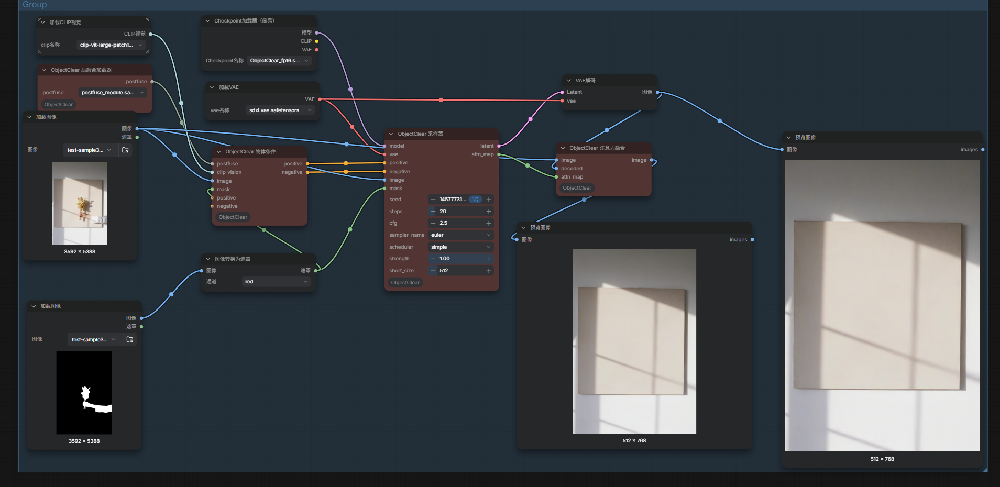

# ComfyUI_ObjectClear
[ObjectClear](https://github.com/zjx0101/ObjectClear):Complete Object Removal via Object-Effect Attention,you can try it in ComfyUI

# Update
* 调用agent重新封装此方法 // call agent to encapsulate this method again

# 1 . Installation /安装

In the ./ComfyUI /custom_nodes directory, run the following:   
```
git clone https://github.com/smthemex/ComfyUI_ObjectClear.git
```
---

# 2 . Requirements  
```
pip install -r requirements.txt
```

# 3 . Model/模型
* [jixin0101/ObjectClear](https://huggingface.co/jixin0101/ObjectClear/tree/main)  download files as below /下载下方列出的模型:
```
├── comfyUI/models/checkpoints/
|   ├──diffusion_pytorch_model.safetensors    #rename it
├── vae/
|   ├──sdxl.vae.safetensors    
├── clip_vision/
|   ├── clip-vit-large-patch14.safetensors
├── clip/
|   ├── postfuse_module.safetensors   


```

# 4 . Example



# 5 .Tips/使用说明
* 支持单图或多图，遮罩合并用插件带的batch节点，512是垫图最小短边尺寸（会自动裁切），模型用512*512训练的，按理此尺寸是最好的。
* Support single or multiple images, use batch nodes with plugins for mask merging, 512 is the input image ‘s minimum short edge size, and the model is trained with 512 * 512, which is theoretically the best size.

# 6. Citation
```
@InProceedings{zhao2025ObjectClear,
    title     = {{ObjectClear}: Complete Object Removal via Object-Effect Attention},
    author    = {Zhao, Jixin and Zhou, Shangchen and Wang, Zhouxia and Yang, Peiqing and Loy, Chen Change},
    booktitle = {arXiv preprint arXiv:2505.22636},
    year      = {2025}
    }
```
